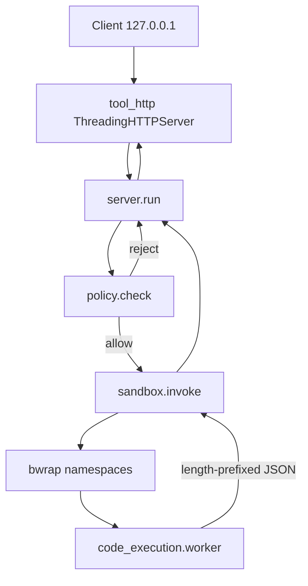
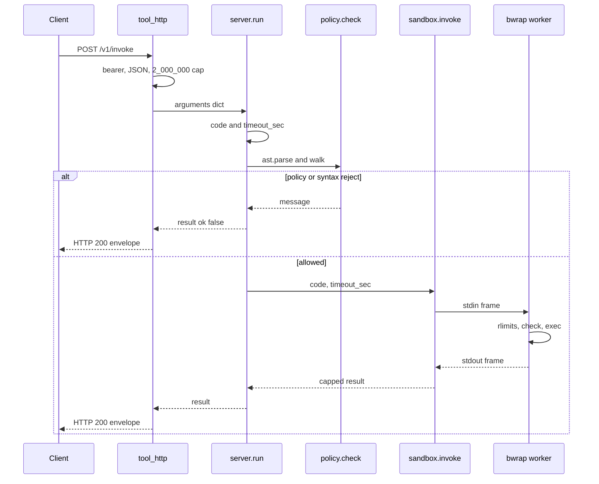

# Per-invoke bubblewrap worker for code_execution

| Field | Value |
| --- | --- |
| Author | Evgeniy Chistyakov |
| Date | 2026-10-16 |
| Status | Draft |
| Package | `tool-code-execution` 1.0.0 (`pyproject.toml`, `src/code_execution/__init__.py`) |
| Scope | This repository only |

## Overview

`code_execution` is a loopback HTTP tool that runs short Python snippets. Today `run()` in `src/code_execution/server.py` AST-checks the source and then `exec`s it in the server interpreter. `timeout_sec` is advertised in `SCHEMA` and never applied. Allowed imports include `io`, `operator`, `functools`, and `string`, which are known ways out of a pure-Python allowlist, and `__import__` is not installed, so an allowlisted `import math` cannot succeed. Compose publishes `127.0.0.1:8091` and sets `TOOL_OFFLINE=1`, but the flag is unread and the snippet shares the server's network namespace, uid, and filesystem.

The server process stays. Each invoke that passes the AST filter runs in a new `bwrap` child with its own user, mount, pid, network, ipc, and uts namespaces. The mount namespace starts empty. The interpreter and stdlib are read-only binds. A 16 MiB tmpfs is the only writable directory. The parent kills the sandbox's pid 1, which the kernel turns into a kill of the worker and of any grandchild in that pid namespace, when `timeout_sec` expires. If `bwrap` is missing or the namespaces cannot be built, the call returns a sandbox error and does not `exec` in-process.

`import math` returns a proxy, not the real `math` module. The proxy exposes a named attribute list and nothing else, so `enum.bltns`, `enum.sys`, and `collections._sys` are not reachable. The AST walk remains a reject-before-exec filter. It is not the security boundary. The boundary is the namespace setup plus the parent kill of pid 1.

## Background & Motivation

### Current process

`src/tool_http.py` serves `ThreadingHTTPServer`. `GET /healthz` and `GET /health` are unauthenticated. `GET /schema` is unauthenticated. `POST /v1/invoke` and `POST /invoke` require `Authorization: Bearer $TOOL_TOKEN` (default `local`; an empty `TOOL_TOKEN` skips the check). The body is JSON, either `{"arguments": {...}}` or the arguments object itself. Payload cap is 2_000_000 bytes. Success is HTTP 200 `{"ok": true, "tool": "code_execution", "result": <run() dict>}`. `PermissionError` is HTTP 401. Every other exception is HTTP 400 with `error` and `trace` set to the last 1500 characters of `traceback.format_exc()`, which includes server file paths.

`code_execution.server.run()`:

- Requires a non-empty `code` string of at most 40_000 characters.
- `ast.parse` is called **outside** the `try` that returns a dict. A syntax error propagates out of `run()`. `tool_http.do_POST` catches it in `except Exception` (`src/tool_http.py` line 69) and returns HTTP 400 with `error` and `trace`. That is today's syntax path, not the dict returned for a caught execution failure.
- `_Guard` then walks imports, dunder attributes, and a small set of names. A guard `ValueError` is caught and returned as `ok: false`.
- `compile`s and `exec`s in the server process with a stripped `__builtins__` and `redirect_stdout` / `redirect_stderr`.
- On success returns `stdout` tail 8000, `stderr` tail 2000, `ok: true`.
- On a caught execution failure returns `stdout` tail 2000, `stderr` plus traceback tail 4000, `ok: false`, `error`. That path is HTTP 200, because `run()` returned a dict.

`_ALLOWED_IMPORT_ROOTS` is `math`, `statistics`, `json`, `re`, `datetime`, `collections`, `itertools`, `functools`, `decimal`, `fractions`, `string`, `textwrap`, `unicodedata`, `hashlib`, `base64`, `csv`, `io`, `copy`, `operator`, `typing`, `dataclasses`, `enum`, `numbers`. The builtins dict has no `__import__`, so import statements that pass the guard die with `ImportError` at runtime. `io.open` is a second open. `operator.attrgetter`, `functools`, and `string.Formatter` perform attribute access from C or from a runtime string, which `_Guard.visit_Attribute` never sees. `"{0.__class__}".format(obj)` is the same hole without those modules.

`serve()` defaults to `TOOL_HOST=127.0.0.1` and `TOOL_PORT=8090`. README, `Dockerfile` (`EXPOSE 8091`), and `docker-compose.yml` use 8091. Compose sets in-container `TOOL_HOST=0.0.0.0` so the published `127.0.0.1:8091:8091` mapping reaches the process. That in-container bind is required; binding `127.0.0.1` inside the container would not receive Docker's forwarded connections.

The image is `python:3.12-slim-bookworm`, user `tool` uid 10001, `CMD ["python", "-m", "code_execution.server"]`. Compose adds `no-new-privileges:true`, `cap_drop: ALL`, a read-only root, `tmpfs /tmp` of 64m, `mem_limit` 256m, `pids_limit` 128, and `TOOL_OFFLINE=1`. It also bind-mounts the host path `/tmp/tool-code-execution` at `/tmp/tool-data`. Nothing in `server.py` or `tool_http.py` reads that path. It contradicts the "no filesystem" contract.

Tests in `tests/test_tool.py` call `run()` directly. There is no HTTP test, no timeout test, and no test that an allowlisted import works. CI (`.github/workflows/test.yml`) is `pip install -e ".[dev]"` and `pytest -q` on Ubuntu with CPython 3.12. It does not start Docker.

A tight loop blocks one `ThreadingHTTPServer` thread until the client disconnects. A snippet that gets past the AST walk shares the server uid and the server's network namespace. Those are the defects this change closes.

### What has to be true afterward

- A snippet has no route except the loopback interface that `bwrap` 0.8 configures inside the new netns (127.0.0.1/8, no other interface, no default route), and it cannot see a host directory, the server home, `/tmp/tool-data`, or a D-Bus socket.
- `timeout_sec` is a wall-clock kill of the sandbox pid namespace, performed by the parent. The worker and a forked grandchild both die.
- `import math` works and `math.sqrt` runs. `import os`, `open`, `io`, `operator`, `functools`, and `string` do not. Neither does `enum.bltns.open`, `enum.sys`, `collections._sys`, `fractions.operator`, `re.functools`, or `typing.sys`. `str.format` / `format_map` are rejected before exec.
- If the namespaces were not created, no snippet runs.
- `pytest -q` on a host without the `bwrap` binary stays green: namespace tests skip only in that case. If the binary is installed and the production argv probe exits non-zero, `pytest` fails. Tests do not exec in-process instead.

## Goals & Non-Goals

### Goals

- Keep the HTTP surface: same routes, auth, health, schema name, payload cap, and success envelope.
- Run each accepted snippet in a fresh bubblewrap worker. One shot, then the mount namespace is gone.
- Implement `timeout_sec` as a parent-side kill. Default 5. Integers 1 through 30 only.
- Tighten the AST filter and return a proxy for each allowed import. The proxy's attributes are a named list. The real module object is not handed to the snippet.
- Fail closed when bubblewrap or the namespaces are unavailable.
- Default listen port 8091. Drop the host data bind. Stop sending traceback paths to the client.
- Leave `pytest -q` runnable without Docker and without bubblewrap.

### Non-Goals

- A second runtime. No gVisor, no Firecracker, no E2B, no nsjail, no kern-sandbox, no sandtrap.
- A seccomp program inside the sandbox. bubblewrap accepts a compiled cBPF via `--seccomp`. A filter that still runs CPython 3.12 is easy to get wrong, and a wrong filter is not this change. Network and filesystem denial are the namespaces below. A later change can add a filter without widening the HTTP API.
- Cgroup memory or CPU limits inside the sandbox. bubblewrap does not apply them. Compose `mem_limit` / `pids_limit` stay the outer cage. `RLIMIT_*` in the child is the per-snippet backstop.
- A request queue, a new metrics port, or a change to bearer-token rules.
- Re-enabling snippet network through any flag, including the current `TOOL_OFFLINE` variable.
- Windows or macOS execution. Policy and HTTP tests stay pure Python. A live worker requires Linux namespaces.

## Proposed Design

### Process model



The server interpreter never calls `exec` on snippet source. The only `exec` of snippet bytecode is in `src/code_execution/worker.py`, and that module is started as the bwrap command. `src/code_execution/server.py` keeps `SCHEMA`, `run`, and `main`. `main` still calls `tool_http.serve`.

New modules, all under `src/code_execution/`:

| Module | Role |
| --- | --- |
| `policy.py` | Allowlist, `EXPORTS`, `_Guard`, `check`, proxies, `guarded_import`, `execute_source`. Single source for what may run. |
| `protocol.py` | Frame codec and the numeric caps. No I/O, no `bwrap`. |
| `text.py` | `public_message`. Strips path-shaped text. Used by the HTTP layer and the worker. |
| `sandbox.py` | Resolve `bwrap`, build argv, spawn, kill, map failures. No snippet `exec`. |
| `worker.py` | Set rlimits, read one frame, `check` again, `exec`, write one frame. |

`tool_http.py` stays the HTTP implementation. It gains a default port of 8091 and a 400 body with no `trace`.

### Request path



Validation failures (`code` missing, `code` too large, `timeout_sec` not an integer in range, bad JSON, payload too large, arguments not an object) still raise. `tool_http` turns those into HTTP 400. Policy rejects, snippet exceptions, timeouts, and sandbox failures are return values of `run()`, so they stay HTTP 200 with `result.ok == false`. That is the split `run()` already uses for `import os` versus `ValueError("code is required")`. Callers that only read the inner `ok` / `stdout` / `stderr` / `error` fields keep working. `error_class` is added on failure. `trace` is removed.

`run()` does not grow a second implementation. After `policy.check` returns, the only call is `sandbox.invoke`. There is no `if bwrap is None: exec(...)` branch, and tests must be able to see that: when the resolver returns `None`, `subprocess.Popen` is not called.

### Bubblewrap argv

Production binary is `/usr/bin/bwrap` from Debian bookworm package `bubblewrap` (`0.8.0-2+deb12u1`). The helper is not setuid. Do not `chmod u+s` it. Upstream removed the setuid mode; the bookworm package follows that. A setuid helper is not a fallback.

`sandbox.build_bwrap_argv` is a pure function of `(bwrap_path, worker_cmd, cpu_sec, uid, gid, info_fd)`. `info_fd` is the write end of a pipe the caller already created. `sandbox.invoke` fills those in and spawns. Unit tests call the builder with a fake path and an explicit integer and never need a namespace.

Normative argv for the image, uid 10001, `timeout_sec` 5 so the CPU rlimit is 6. `--gid` is `os.getgid()` at runtime; the Dockerfile creates gid 10001 so the image value is stable. Symlink entries are emitted only when that path is a symlink on the host. A real directory is `--ro-bind` instead. A missing path is omitted. The amd64 bookworm image is usrmerge, so the four symlinks below are present. `<info_write>` is the write-end number from `os.pipe()` for that spawn. It is not the constant 3, and it is not a literal argv token.

```text
/usr/bin/bwrap
--unshare-user
--unshare-pid
--unshare-net
--unshare-ipc
--unshare-uts
--die-with-parent
--new-session
--cap-drop ALL
--hostname sandbox
--info-fd <info_write>
--clearenv
--setenv PATH /usr/local/bin:/usr/bin:/bin
--setenv LANG C.UTF-8
--setenv LC_ALL C.UTF-8
--setenv HOME /tmp
--setenv TMPDIR /tmp
--setenv TMP /tmp
--setenv TEMP /tmp
--setenv PYTHONDONTWRITEBYTECODE 1
--setenv PYTHONUNBUFFERED 1
--setenv PYTHONIOENCODING utf-8
--setenv PYTHONUTF8 1
--setenv SANDBOX_RLIMIT_CPU 6
--uid 10001
--gid 10001
--ro-bind /usr /usr
--symlink usr/bin /bin
--symlink usr/lib /lib
--symlink usr/lib64 /lib64
--symlink usr/sbin /sbin
--dev /dev
--perms 0700
--size 16777216
--tmpfs /tmp
--chdir /tmp
--
/usr/local/bin/python3.12 -I -B -u -X utf8 -m code_execution.worker
```

Flag order matters for `--perms` and `--size`: both apply only to the next `--tmpfs`. `--uid` requires `--unshare-user`. `--hostname` requires `--unshare-uts`.

What each flag is for:

| Flag | Why it is here |
| --- | --- |
| `--unshare-user` | Required. Bookworm's non-setuid `bwrap` cannot build the other namespaces without a user namespace. Not `--unshare-user-try`. |
| `--unshare-pid` | Snippet is pid 2 under bwrap's reaper. It cannot address server or host pids. Not `--as-pid-1`. |
| `--unshare-net` | New netns. Not `--share-net`. `bwrap` 0.8 then calls `loopback_setup()` (`network.c` on the v0.8.0 tag): it adds 127.0.0.1/8 and sets `IFF_UP` on `lo`. If that netlink call fails, `bwrap` exits before exec. There is still no second interface and no default route. This server does not add its own address or route. |
| `--unshare-ipc` | No host SysV shared memory or semaphores. |
| `--unshare-uts` | Hostname is `sandbox`, not the host's. |
| `--die-with-parent` | `PR_SET_PDEATHSIG`, `SIGKILL`. Set on the monitor, on pid 1, and on the worker. Cleared by the kernel on `fork`, so it does not cover a grandchild. The pid-namespace kill below does. |
| `--new-session` | `setsid()` in the sandboxed child, before it forks the worker (`bubblewrap.c` on v0.8.0). No controlling terminal. The worker is therefore not in the monitor's process group. |
| `--info-fd <info_write>` | The write end `os.pipe()` just returned, not the literal 3. `bwrap` 0.8 writes `{"child-pid": N, ...}` to that integer before `monitor_child`. A failed write is `die_with_error("Write to info_fd")` and the process exits during setup. `N` is the external pid of the raw_clone child, which becomes pid 1. The parent reads `N` from the other end of the same pipe. |
| `--cap-drop ALL` | Documented on the command line. Unprivileged bwrap already leaves no permitted caps. There is no `--cap-add`. |
| `--clearenv` | The child does not inherit `TOOL_TOKEN`, `TOOL_HOST`, proxy variables, or `DBUS_SESSION_BUS_ADDRESS`. |
| `--ro-bind /usr /usr` | Interpreter, stdlib, and (after a non-editable install) `site-packages`. Read-only. |
| Symlinks for `/bin` `/lib` `/lib64` `/sbin` | Usrmerge. The dynamic linker keeps working. Omit any of these that do not exist (arm64 has no `/lib64`). |
| `--dev /dev` | On `bwrap` 0.8 this is a new tmpfs plus a bind of six host nodes: `null`, `zero`, `full`, `random`, `urandom`, `tty` (`SETUP_MOUNT_DEV` in `bubblewrap.c`). Not `--dev-bind /dev /dev`. Host disks are not mounted. It also sets `opt_needs_devpts`, which makes unprivileged `bwrap` map uid 0 in the first user namespace and then `unshare(CLONE_NEWUSER)` once more to map back to the real uid. That second `unshare` does not write a sysctl. |
| `--tmpfs /tmp` 16777216 bytes, mode `0700` | Only writable directory. Counts against the container memory limit. |
| `--chdir /tmp` | Cwd exists inside the namespace. |

Deliberately absent:

- `--disable-userns`. On `bwrap` 0.8 this writes `1` to `/proc/sys/user/max_user_namespaces` through the `/proc` fd it opened before pivot (`openat(proc_fd, "sys/user/max_user_namespaces", O_WRONLY)`), then enters another user namespace. OCI's default readonly paths include `/proc/sys`. This compose file does not clear them. A read-only mount stays read-only for uid 10001. The write fails, `bwrap` exits during setup, and every invoke would return `SandboxError`. Making that one sysctl writable without unmasking `/proc/kcore` is not available with `cap_drop: ALL` and without `systempaths=unconfined`. The flag is not in the argv and not in the probe. Nested user namespaces are an accepted residual; see Key Decision 9.
- `--unshare-all`. In `bwrap` 0.8 that expands to `--unshare-user-try` and `--unshare-cgroup-try`. The `-try` forms skip a namespace when the kernel refuses it and still run the command. That is a silent weakening. This server uses the non-try flags and treats a non-zero `bwrap` status as failure.
- `--unshare-cgroup`. A cgroup namespace does not apply the memory or pid cap (compose already does) and `unshare(CLONE_NEWCGROUP)` fails in some container runtimes even when user, pid, and net namespaces work. Omitting it avoids a false sandbox failure. Do not pass `--unshare-cgroup-try` either. The first `raw_clone` therefore does not set `CLONE_NEWCGROUP`.
- `--proc /proc` and any bind of the container `/proc`. A fresh procfs mount is rejected inside Docker when `/proc/kcore` and similar paths are masked (`bwrap: Can't mount proc on /proc: Operation not permitted`). Binding the container `/proc` would show the server and every other worker. `systempaths=unconfined` would unmask `/proc/kcore` for the whole container. None of those are acceptable. The pid namespace is still created. CPython is started by absolute path, so it does not need `/proc/self/exe`. The same choice is why `--disable-userns` cannot be used: the sysctl it writes lives on that read-only `/proc/sys`.
- `--ro-bind / /`, host `/home`, `/root`, `/etc`, `/run`, `/var`, `/tmp`, `/dev/shm`, and `/tmp/tool-data`.
- D-Bus. No `/run/user/*/bus`, no `/var/run/dbus`, and the session address is cleared with the environment. `HOME` is `/tmp` inside the sandbox, which is the new tmpfs, not `/home/tool`.
- Any writable bind. The snippet cannot be given a host directory to "help" it.

Dev and CI hosts install the package editable into a venv whose prefix is not under `/usr`. The builder adds, in this order, only if the path is not already covered by `/usr`:

1. `--ro-bind` of `sys.base_prefix` at the same path.
2. `--ro-bind` of `sys.prefix` at the same path.
3. `--ro-bind` of the directory that contains the `code_execution` package (`Path(code_execution.__file__).resolve().parent.parent`) at the same path, when the package is not inside the prefix. That is the editable `src/` tree. Do not bind the repository root, `.git`, or `Path.home()`.

The worker command is always:

```text
os.path.realpath(sys.executable) -I -B -u -X utf8 -m code_execution.worker
```

`-I` is isolated mode (no user site, no `PYTHONPATH`). `-B` suppresses bytecode writes. `-u` is unbuffered stdio. The absolute executable path is required because `/proc` is not mounted. Source is not placed in `argv`, so the container process list does not show the snippet.

`Popen` uses `env={"PATH": "/usr/bin:/bin"}` even though `bwrap` is an absolute path, so the parent environment's `TOOL_TOKEN` is not copied into the `bwrap` process. `stdin`, `stdout`, and `stderr` are pipes. `start_new_session=True` makes the monitor its own session leader. That does not put the worker in the same process group: `bwrap` calls `setsid()` again inside the sandbox before the worker fork.

The info pipe is created in the parent and is not renumbered:

```python
info_read, info_write = os.pipe()
argv = build_bwrap_argv(..., info_fd=info_write)
proc = subprocess.Popen(
    argv,
    stdin=subprocess.PIPE,
    stdout=subprocess.PIPE,
    stderr=subprocess.PIPE,
    close_fds=True,
    pass_fds=(info_write,),
    start_new_session=True,
    env={"PATH": "/usr/bin:/bin"},
)
os.close(info_write)
```

`pass_fds` keeps `info_write`'s existing number. That number is the `--info-fd` argument. `close_fds=True` closes every other descriptor in the child, including the read end and the listening socket. `Popen` then installs its own pipes on 0, 1, and 2. There is no `preexec_fn` and no `os.dup2` onto 3. After `listen`, fd 3 is commonly the accept socket of `ThreadingHTTPServer`. A `dup2` of the write end onto 3 in the parent would close that socket for every thread. `os.pipe()` is called while 0, 1, and 2 are already open, so both ends are above 2 and `Popen` does not overwrite `info_write` when it installs stdio.

The parent reads `child-pid` from `info_read`. It does not read fd 3. Closing the parent's copy of `info_write` is what lets that read finish: `bwrap` writes one JSON object and closes its end, and a parent that still holds the write end never sees EOF. The read end is not in `pass_fds`. A hardcoded `--info-fd 3` is closed in the child unless 3 happens to be this write end, `dump_info` dies, and the payload never runs.

### Process tree and kill

`bwrap` 0.8 with `--unshare-pid` and without `--as-pid-1` is three processes, all counting against `pids_limit`, before the snippet forks:

```text
server thread
  └── monitor          Popen's pid. Outside the sandbox pid namespace.
        └── pid 1      raw_clone child. do_init reaper inside the pid namespace.
              └── pid 2   the worker, after exec of python.
                    └── grandchild   only if the worker forks. Not in the tree until then.
```

`raw_clone` is one syscall from the monitor's child setup, with flags `SIGCHLD | CLONE_NEWNS | CLONE_NEWUSER | CLONE_NEWPID | CLONE_NEWNET | CLONE_NEWIPC | CLONE_NEWUTS` (`bubblewrap.c` on the v0.8.0 tag). It is not an `unshare` of those flags one at a time. The parent of that clone is the monitor. The child is what `--info-fd` reports as `child-pid`. With `--dev` and a non-zero `--uid`, that child later `unshare(CLONE_NEWUSER)` a second time to drop the temporary uid-0 map used for the devpts binds. It then `setsid()` and `fork()`s. The forking process becomes pid 1 (`do_init`). The new child is pid 2 and execs the worker. `--die-with-parent` runs `prctl(PR_SET_PDEATHSIG, SIGKILL)` in the monitor, again at the start of `do_init`, and again in pid 2 before exec.

`PR_SET_PDEATHSIG` is cleared on `fork`. A grandchild of pid 2 does not have it. `os.killpg(monitor_pid)` does not signal pid 1 or pid 2: they called `setsid()` and left the monitor's session. Killing only the monitor and waiting for the PDEATHSIG chain also misses a grandchild that cleared the signal or called `setsid()` itself, until pid 1 actually exits.

The kill used on timeout, on an output-cap breach, and on any path that must stop the sandbox:

1. `SIGKILL` `child-pid` from `--info-fd`. That pid is pid 1 of the sandbox pid namespace. When a pid namespace's init exits, the kernel sends `SIGKILL` to every remaining task in that namespace. The worker and a grandchild die even if they are in another session and even if they cleared `PDEATHSIG`.
2. `SIGKILL` the monitor by pid, not by process group. If `--info-fd` has not produced a pid yet, this is the only signal we can send. Pid 1's `PDEATHSIG` then fires, and step 1's kernel rule follows.
3. `wait` the monitor, bounded by 2 seconds, then `SIGKILL` again if it is still there.

`killpg` is not part of this sequence. `--new-session` stays, because the terminal disconnect is still wanted; the kill does not depend on the process group.

### Why this works as uid 10001

`USER tool` is uid 10001 with no capabilities. `cap_drop: ALL` and `no-new-privileges:true` stay. They do not by themselves forbid user namespaces. Creating a user namespace does not require `CAP_SYS_ADMIN` in the parent namespace when the kernel allows unprivileged user namespaces (`kernel.unprivileged_userns_clone=1`, the default on Debian kernels since 5.10, including bookworm's 6.1). Inside that user namespace the process is privileged over the namespaces it creates, which is what `bwrap` uses to mount. `no-new-privileges` blocks setuid exec; it is not the userns switch. There is no setuid `bwrap` to fall back to, and this design does not add one.

Docker's default seccomp profile, evaluated once from the container's capability set, is the filter this image has to extend. `includes.caps` and `excludes.caps` are applied when the OCI filter is built. They are not re-checked against the calling thread's capabilities at syscall time. With `cap_drop: ALL` the container does not have `CAP_SYS_ADMIN`, so the profile's "allow `clone`, `unshare`, `mount`, `pivot_root`, `sethostname` if the container has `CAP_SYS_ADMIN`" rule is omitted for the life of the container. Gaining `CAP_SYS_ADMIN` inside the new user namespace does not put that rule back. The first `raw_clone` also does not match the profile's other `clone` allow, which keeps `clone` only when none of the namespace bits in `0x7E020000` are set (`(flags & 2114060288) == 0`, `valueTwo` omitted). `bwrap` 0.8 calls `syscall(__NR_clone, flags, child_stack)`, not `clone3`. The pinned profile in [Container cage](#container-cage) adds the allows that this binary actually issues.

Host AppArmor is out of scope for this change. No AppArmor profile is shipped. `docker-default`'s `deny mount` and Ubuntu's `kernel.apparmor_restrict_unprivileged_userns` are properties of the host Docker daemon, not of the bookworm image. A profile has not been loaded in this workspace, so this document does not include one. On a host where that daemon denies the mount, `bwrap` exits non-zero and the call fails closed. `apparmor=unconfined` and `seccomp=unconfined` are not substitutes. `--cap-add SYS_ADMIN` is not a substitute.

The supported cage is this image on a host that does not add another mandatory access check around mount: a developer machine or CI runner with `bubblewrap` installed, and the compose service with the seccomp file below. `pytest` runs the production argv there. It does not start Docker.

Startup, before `serve_forever`, runs that same argv with `python -I -B -c 'print("ready")'` and a 10 second timeout. Same flags as an invoke, including `--dev` and the sized tmpfs. `--info-fd` is the write end of the pipe created for this probe, the same number `pass_fds` carries. No `--disable-userns` and no fixed fd 3. The line on stderr is `sandbox bwrap=/usr/bin/bwrap probe=ready` or `sandbox bwrap=missing probe=unavailable` or `sandbox bwrap=/usr/bin/bwrap probe=denied exit=N`. Health stays `{"status":"ok","tool":"code_execution","mode":"local"}` either way. A process that cannot sandbox stays up so the failure is visible on invoke. The probe does not run snippet source. This probe is owned by PR 4.

### Protocol

One request, one response, then the worker exits. No pickle. No second frame.

```text
uint32 big-endian byte length
UTF-8 JSON of exactly that many bytes
```

`protocol.py`:

```python
VERSION = 1
MAX_CODE_CHARS = 40_000
MAX_REQUEST_FRAME = 262_144   # 40_000 chars, worst-case UTF-8, plus JSON
MAX_RESPONSE_FRAME = 131_072
MAX_WORKER_STDERR = 8_192
STDOUT_CAP_OK = 8_000
STDERR_CAP_OK = 2_000
STDOUT_CAP_ERR = 2_000
STDERR_CAP_ERR = 4_000
ERROR_CAP = 300
DEFAULT_TIMEOUT_SEC = 5
MIN_TIMEOUT_SEC = 1
MAX_TIMEOUT_SEC = 30
DEFAULT_PORT = 8091
RLIMIT_AS = 201_326_592       # 192 MiB
RLIMIT_FSIZE = 1_048_576      # 1 MiB; never 0
RLIMIT_NOFILE = 64
RLIMIT_NPROC = 32
TMPFS_BYTES = 16_777_216
```

Request object, compact separators, `ensure_ascii=False`:

```json
{"v":1,"code":"import math\nprint(math.sqrt(4))\n"}
```

`v` must be `1`. `code` is the same string `policy.check` already accepted. The parent does not send `timeout_sec` inside the JSON. The CPU ceiling travels as `SANDBOX_RLIMIT_CPU`, which is cleared from the snippet's point of view only by never handing it `os`. The worker treats a missing or out-of-range value as a fatal setup error and does not exec.

Response:

```json
{"v":1,"ok":true,"stdout":"2.0\n","stderr":""}
```

```json
{"v":1,"ok":false,"stdout":"","stderr":"","error_class":"ZeroDivisionError","error":"division by zero"}
```

The worker applies the stdout/stderr tails before it encodes, so the response frame stays small. The parent decodes and builds a new dict with only the known keys. It ignores unknown fields. It rejects `v != 1`, a non-bool `ok`, a non-string stream, an `error_class` that is not `^[A-Za-z_][A-Za-z0-9_]{0,63}$`, or a frame longer than `MAX_RESPONSE_FRAME`. Those become `error_class` `SandboxError` and `error` `worker protocol error`. The raw bytes are not copied into the HTTP body.

Snippet `print` must not write the protocol stream. The worker dupes nothing exotic: it `redirect_stdout` / `redirect_stderr` to `io.StringIO` around `exec`, using the real builtin `print` (it looks up `sys.stdout` on each call). After the `with` block exits, the protocol frame is written to the real stdout and flushed. Stderr of the worker process is reserved for a crash before a frame exists. The parent logs a truncation of that stderr and does not return it to the client.

`MAX_REQUEST_FRAME` is 256 KiB because 40_000 non-BMP characters are 160_000 UTF-8 bytes. The character cap is unchanged. The HTTP payload cap stays 2_000_000.

### Parent wait, timeout, and caps

`subprocess.run(..., timeout=)` kills the direct child and raises `TimeoutExpired` only after the child has been waited for. This server needs the same contract and a hard cap on bytes, which `subprocess.run` does not provide: `communicate` will buffer a hostile or buggy writer until the timeout. `sandbox.invoke` uses `subprocess.Popen` and a `select` loop.

```python
def _kill(proc: subprocess.Popen, child_pid: int | None) -> None:
    if child_pid is not None:
        try:
            os.kill(child_pid, signal.SIGKILL)
        except ProcessLookupError:
            pass
    if proc.poll() is None:
        try:
            os.kill(proc.pid, signal.SIGKILL)
        except ProcessLookupError:
            pass
    try:
        proc.wait(timeout=2)
    except subprocess.TimeoutExpired:
        try:
            os.kill(proc.pid, signal.SIGKILL)
        except ProcessLookupError:
            pass
        proc.wait(timeout=2)
```

`child_pid` is the integer parsed from `info_read`, or `None` when that JSON has not arrived. `os.kill` targets that pid and then the monitor pid. It does not call `os.killpg`. See [Process tree and kill](#process-tree-and-kill).

The loop:

- Puts stdin, stdout, stderr, and `info_read` in non-blocking mode. Reads `info_read` in the same `select` and keeps the first `child-pid` integer. Closes `info_read` once that object is in hand.
- Writes the request frame as the socket is writable. A child that never reads stdin still hits the deadline, because the write is inside the loop.
- Closes stdin when the frame is fully written.
- Appends reads to bounded buffers. stdout cap is `MAX_RESPONSE_FRAME` (131_072). stderr cap is `MAX_WORKER_STDERR` (8_192). One extra byte is a cap breach: call `_kill`, return `SandboxError` / `worker output exceeded cap`. Do not return the bytes.
- On `time.monotonic() - start >= timeout_sec`: call `_kill`, return the timeout result. Do not parse a partial frame. Partial snippet output is discarded. The client cannot tell a killed write from a snippet that printed nothing, which is acceptable: the deadline fired before a committed result.
- On both pipes EOF: `wait` for the exit status with a 1 second bound, then decode.

Timeout result, always this shape, HTTP 200:

```json
{
  "ok": true,
  "tool": "code_execution",
  "result": {
    "ok": false,
    "stdout": "",
    "stderr": "",
    "error_class": "TimeoutExpired",
    "error": "execution timed out after 5s"
  }
}
```

`5` is the requested `timeout_sec`. The outer `ok: true` means the HTTP handler finished. The inner `ok: false` means the snippet did not. That matches today's wrapper: `run()` returns a dict and `tool_http` does not inspect it.

`timeout_sec` covers process creation and `bwrap` setup, not only the snippet. A value of 1 can fire during a cold Python start. There is no hidden grace period. The default remains 5. The integration test uses `while True: pass` with `timeout_sec=1` and asserts the call returns in under 5 seconds with `error_class == "TimeoutExpired"`.

Exit mapping when no valid frame arrives:

| Condition | `error_class` | `error` |
| --- | --- | --- |
| Wait hit `timeout_sec` | `TimeoutExpired` | `execution timed out after {n}s` |
| Return code `-SIGKILL` or `-SIGXCPU` and elapsed `>= timeout_sec - 0.5` | `TimeoutExpired` | same |
| Any other non-zero exit, setup failure, or bad frame, elapsed below that | `SandboxError` | `worker exited {code}` or `worker protocol error` or `bubblewrap is not available` |

`SIGXCPU` is the rlimit backstop. Classifying a late `SIGXCPU` as `TimeoutExpired` keeps one client-visible timeout. An immediate `bwrap` refusal (permission denied on the uid map, command not found) has a small elapsed time and a non-signal status, so it stays `SandboxError` and is not reported as a timeout. `bwrap`'s stderr is logged server-side only, one line, truncated to 300 characters, paths stripped. It is not a response field.

The parent re-applies the tails even if the worker misbehaves: success stdout 8000 / stderr 2000, failure stdout 2000 / stderr 4000, `error` through `public_message` at 300 characters.

### Worker

`worker.main` order is fixed:

1. Read `SANDBOX_RLIMIT_CPU`. If it is not an int in `2..31`, exit 2 with no frame.
2. Set rlimits, soft and hard to the same value, so the snippet cannot raise them. `resource` is imported here and is not on the snippet allowlist.

| Limit | Value | Note |
| --- | --- | --- |
| `RLIMIT_CPU` | `timeout_sec + 1` (2..31) | CPU seconds, not wall clock. The parent remains the wall-clock kill. |
| `RLIMIT_AS` | 201_326_592 (192 MiB) | Stops a huge `mmap`. CPython 3.12's virtual size is larger than its RSS; 128 MiB is tight enough to `MemoryError` during import on some builds. 192 MiB is the chosen cap. Compose's 256m is RSS and still bounds the resident set. |
| `RLIMIT_NOFILE` | 64 | stdin, stdout, stderr, and shared-library opens during preload. |
| `RLIMIT_NPROC` | 32 | Linux counts threads. High enough for the interpreter, far under compose `pids_limit` 128. |
| `RLIMIT_FSIZE` | 1_048_576 | Not 0. `RLIMIT_FSIZE=0` can kill a process that writes a regular file for its own diagnostic output. Pipes are not covered by this limit; the 1 MiB value only caps files on the tmpfs. |
| `RLIMIT_CORE` | 0 | No core file on the tmpfs. |
| `RLIMIT_MEMLOCK` | 0 | |
| `RLIMIT_MSGQUEUE` | 0 | |

`RLIMIT_STACK` is left at the system default. A small stack breaks the interpreter.

3. Read one request frame from stdin. Failure exits 2.
4. `policy.check(code)` again. The parent already checked. The worker does not trust that, because it is a separate program with a real interpreter.
5. Preload the allowlist with the real import system (done once at process start, before `exec`, after rlimits). Call `policy.execute_source`. That is the only `exec` of snippet source. `server.run` does not call it.
6. Catch `BaseException`, including `SystemExit`. Write one response frame. Exit 0 if the frame was written.

A snippet `SystemExit` must not skip the frame. The parent would otherwise treat it as a sandbox crash. `error_class` is `SystemExit`.

Rlimits are set in the worker rather than in `preexec_fn`. `preexec_fn` after `fork` in a `ThreadingHTTPServer` process can deadlock on a lock held by another thread. The snippet cannot call `setrlimit` unless it has already escaped the import hook; the namespace boundary still holds if it has. The numbers above are also the first thing the worker does, before it reads the snippet.

If step 2 or the preload raises, the worker writes a `SandboxError` frame when stdout is still usable, otherwise exits 2. It does not exec the snippet.

### Policy

`policy.py` is imported by `server.py` and by `worker.py`. The allowlist constant is the only list.

```python
ALLOWED_MODULES = frozenset({
    "math", "statistics", "json", "re", "datetime", "collections",
    "itertools", "decimal", "fractions", "textwrap", "unicodedata",
    "hashlib", "base64", "csv", "copy", "typing", "dataclasses",
    "enum", "numbers",
})

FORBIDDEN_MODULES = frozenset({
    "os", "sys", "subprocess", "socket", "shutil", "pathlib", "ctypes",
    "multiprocessing", "threading", "signal", "importlib", "builtins",
    "posix", "nt", "fcntl", "pty", "resource", "http", "urllib", "requests",
    "webbrowser", "tempfile", "pickle", "marshal", "code", "codeop",
    "io", "operator", "functools", "string", "mmap",
})
```

Removed from the allowlist: `io`, `operator`, `functools`, `string`. They are added to `FORBIDDEN_MODULES` so a later edit that puts them back into `ALLOWED_MODULES` still fails the guard. `io` is removed as a whole module, including `BytesIO` and `StringIO`. `io.open` and `io.FileIO` are the bypass; exposing the module object exposes them. In-memory buffers are `str`, `bytes` is not added, and `list`. No per-callable injection of `io.BytesIO`.

`operator`, `functools`, and `string` are not re-introduced as individual callables. `operator.attrgetter` and `string.Formatter` are the reflection paths that an AST walk does not see. Callers format with f-strings or `%`.

The guard rejects:

- `Import` / `ImportFrom` whose module string is not an exact member of `ALLOWED_MODULES`. `import collections.abc` and `from collections.abc import Mapping` are rejected. `import math` and `from math import sqrt` are accepted. `node.level != 0` (relative import) is rejected. An imported name that starts with `_` is rejected.
- Any `ast.Name` whose `id` is in the blocked set, or starts with `__`. The blocked set is the current one (`__import__`, `eval`, `exec`, `compile`, `open`, `input`, `breakpoint`) plus `getattr`, `setattr`, `delattr`, `globals`, `locals`, `vars`, `dir`, `type`, `object`, `super`, `classmethod`, `staticmethod`, `property`, `memoryview`, `help`, `format`, `format_map`, `hasattr`, `id`, `callable`.
- Any `ast.Attribute` whose `attr` starts with `__` (keeps today's dunder ban, which also covers f-string expressions such as `f"{obj.__class__}"`).
- Any `ast.Attribute` whose `attr` is `format` or `format_map`. That is `"{0.__class__}".format(obj)`, including a lookup that is not immediately called.

`check` raises `SyntaxError` from `ast.parse`, or `ValueError` with the existing message text (`import blocked: ...`, `name blocked: ...`, `dunder attribute access blocked`) plus `method blocked: format`. `run()` maps `SyntaxError` to `error_class` `SyntaxError` and guard `ValueError` to `error_class` `PolicyError`, without spawning.

Dotted imports stay illegal on purpose. `from math import sqrt` loads the module `math` and then reads an attribute; it does not need `collections.abc`. Allowing every submodule of an allowed root would track a moving stdlib surface. Submodules are a later allowlist edit, not an implicit rule.

### How `import math` succeeds

The worker preloads with the real import system, then `policy.execute_source` runs the snippet under a builtins dict whose `__import__` is the hook below. The hook never calls the real `__import__`, and it never returns a `types.ModuleType`.

CPython stores `sys`, `builtins`, `operator`, and `functools` on allowlisted modules under ordinary names. On 3.12 and on 3.14 those include `enum.bltns`, `enum.sys`, `collections._sys`, `statistics.sys`, `fractions.sys`, `fractions.operator`, `fractions.functools`, `typing.sys`, `typing.operator`, `dataclasses.sys`, and `re.functools`. `math.sqrt.__self__` is the real `math` module. `statistics.mean.__globals__` contains `sys`. An AST ban on dunder attributes does not see `enum.bltns` or `collections._sys`. Handing the snippet the real module object fails the allowlist. The hook returns a slots proxy built from `EXPORTS`.

```python
_DENY_NAMES = frozenset({
    "sys", "bltns", "builtins", "operator", "functools", "os", "io", "open",
    "eval", "exec", "compile", "getattr", "setattr", "delattr", "__import__",
    "types", "importlib", "inspect", "subprocess", "socket", "ctypes",
    "pickle", "string", "pathlib", "shutil", "mmap",
})

class _Call:
    __slots__ = ("_fn",)
    def __init__(self, fn):
        object.__setattr__(self, "_fn", fn)
    def __getattribute__(self, name):
        raise AttributeError(name)
    def __call__(self, *args, **kwargs):
        fn = object.__getattribute__(self, "_fn")
        return _wrap(fn(*_unwrap(args), **{k: _unwrap(v) for k, v in kwargs.items()}))

class _Mod:
    __slots__ = ("_names",)
    def __init__(self, names):
        object.__setattr__(self, "_names", names)
    def __getattribute__(self, name):
        if not isinstance(name, str) or name[:1] == "_" or name in _DENY_NAMES:
            raise AttributeError(name)
        names = object.__getattribute__(self, "_names")
        try:
            return names[name]
        except KeyError:
            raise AttributeError(name) from None
    def __setattr__(self, name, value):
        raise AttributeError(name)
```

`_Type` and `_Instance` use the same `__slots__` and the same name check as `_Mod`. A type lookup returns `_wrap` of that attribute. Calling a `_Type` calls the real class and wraps the result. An instance lookup does the same for the real instance. Special methods are implemented on the class, not found through `__getattribute__`: comparison, arithmetic, `__hash__`, `__bool__`, `__len__`, `__iter__`, `__next__`, `__getitem__`, `__setitem__`, `__contains__`, `__enter__`, and `__exit__`. Each one forwards to the inner object and passes the result through `_wrap`. `with` and `for` keep working. Snippet source still cannot spell those dunder names; `_Guard` rejects them.

`_Call.__getattribute__` raises for every name, including `__globals__`, `__self__`, `__code__`, `__closure__`, `__func__`, and `__wrapped__`. `__call__` is a class slot, so `math.sqrt(4)` still runs. `_wrap` returns `None`, `bool`, `int`, `float`, `complex`, `str`, and `bytes` unchanged, and it rebuilds `list`, `tuple`, `dict`, `set`, and `frozenset` from wrapped elements. A `types.ModuleType` makes `_wrap` raise. A `type` becomes a `_Type`. Any other callable becomes a `_Call`. Anything else becomes an `_Instance`. `_unwrap` strips those wrappers before the real callable sees the arguments. `str` stays a real `str`, which is why `format` and `format_map` stay banned in the AST.

```python
def _load_module(module_name: str) -> _Mod:
    real = importlib.import_module(module_name)
    exported = {}
    for name in EXPORTS[module_name]:
        if name[:1] == "_" or name in _DENY_NAMES:
            raise RuntimeError(f"refusing export {module_name}.{name}")
        value = getattr(real, name)
        if isinstance(value, types.ModuleType):
            raise RuntimeError(f"refusing module export {module_name}.{name}")
        exported[name] = _wrap(value)
    return _Mod(exported)

def guarded_import(name, globals=None, locals=None, fromlist=(), level=0):
    if level != 0 or not isinstance(name, str) or name not in _PRELOADED:
        raise ImportError("import blocked")
    return _PRELOADED[name]
```

`preload` calls `_load_module` for every name in `ALLOWED_MODULES` and stores the `_Mod`. A `RuntimeError` from the loader aborts preload. The worker writes `SandboxError` and does not exec. `import math` compiles to `__import__("math")`. The source name `__import__` is still rejected by `_Guard`. `from math import sqrt` receives the `_Mod` and then loads `sqrt`, which is the `_Call` stored in `EXPORTS`. `guarded_import("math") is sys.modules["math"]` is false, and the proxy is not a `ModuleType`.

`EXPORTS` is the whole surface. Names are the 3.11 intersection, so a missing attribute fails preload on the image's 3.12 as well. Not listed, and therefore `AttributeError`: `enum.bltns`, `enum.sys`, `collections._sys`, `statistics.sys`, `fractions.operator`, `fractions.sys`, `fractions.functools`, `re.functools`, `typing.sys`, `typing.operator`, `typing.functools`, `dataclasses.sys`, `unicodedata.ucd_3_2_0`. Also omitted: `statistics.NormalDist`, `collections.namedtuple`, `itertools.batched`, `hashlib.file_digest`, `json.load`, `json.dump`, `csv.QUOTE_STRINGS`, `csv.QUOTE_NOTNULL`, `math.sumprod`.

| Module | Exported names |
| --- | --- |
| `math` | `acos`, `acosh`, `asin`, `asinh`, `atan`, `atan2`, `atanh`, `cbrt`, `ceil`, `comb`, `copysign`, `cos`, `cosh`, `degrees`, `dist`, `e`, `erf`, `erfc`, `exp`, `expm1`, `fabs`, `factorial`, `floor`, `fmod`, `frexp`, `fsum`, `gamma`, `gcd`, `hypot`, `inf`, `isclose`, `isfinite`, `isinf`, `isnan`, `isqrt`, `lcm`, `ldexp`, `lgamma`, `log`, `log10`, `log1p`, `log2`, `modf`, `nan`, `nextafter`, `perm`, `pi`, `pow`, `prod`, `radians`, `remainder`, `sin`, `sinh`, `sqrt`, `tan`, `tanh`, `tau`, `trunc`, `ulp` |
| `statistics` | `correlation`, `covariance`, `fmean`, `geometric_mean`, `harmonic_mean`, `linear_regression`, `mean`, `median`, `median_grouped`, `median_high`, `median_low`, `mode`, `multimode`, `pstdev`, `pvariance`, `quantiles`, `stdev`, `variance` |
| `json` | `dumps`, `loads`, `JSONDecodeError` |
| `re` | `A`, `ASCII`, `DOTALL`, `I`, `IGNORECASE`, `L`, `LOCALE`, `M`, `MULTILINE`, `Match`, `Pattern`, `S`, `U`, `UNICODE`, `VERBOSE`, `X`, `compile`, `escape`, `findall`, `finditer`, `fullmatch`, `match`, `search`, `split`, `sub`, `subn` |
| `datetime` | `MAXYEAR`, `MINYEAR`, `UTC`, `date`, `datetime`, `time`, `timedelta`, `timezone`, `tzinfo` |
| `collections` | `ChainMap`, `Counter`, `OrderedDict`, `defaultdict`, `deque` |
| `itertools` | `accumulate`, `chain`, `combinations`, `combinations_with_replacement`, `compress`, `count`, `cycle`, `dropwhile`, `filterfalse`, `groupby`, `islice`, `pairwise`, `permutations`, `product`, `repeat`, `starmap`, `takewhile`, `tee`, `zip_longest` |
| `decimal` | `BasicContext`, `Decimal`, `DefaultContext`, `ExtendedContext`, `MAX_EMAX`, `MAX_PREC`, `MIN_EMIN`, `ROUND_05UP`, `ROUND_CEILING`, `ROUND_DOWN`, `ROUND_FLOOR`, `ROUND_HALF_DOWN`, `ROUND_HALF_EVEN`, `ROUND_HALF_UP`, `ROUND_UP`, `getcontext`, `localcontext`, `setcontext` |
| `fractions` | `Fraction` |
| `textwrap` | `TextWrapper`, `dedent`, `fill`, `indent`, `shorten`, `wrap` |
| `unicodedata` | `bidirectional`, `category`, `combining`, `decimal`, `decomposition`, `digit`, `east_asian_width`, `is_normalized`, `lookup`, `mirrored`, `name`, `normalize`, `numeric`, `unidata_version` |
| `hashlib` | `algorithms_available`, `algorithms_guaranteed`, `blake2b`, `blake2s`, `md5`, `new`, `pbkdf2_hmac`, `scrypt`, `sha1`, `sha224`, `sha256`, `sha384`, `sha3_224`, `sha3_256`, `sha3_384`, `sha3_512`, `sha512`, `shake_128`, `shake_256` |
| `base64` | `a85decode`, `a85encode`, `b16decode`, `b16encode`, `b32decode`, `b32encode`, `b32hexdecode`, `b32hexencode`, `b64decode`, `b64encode`, `b85decode`, `b85encode`, `decodebytes`, `encodebytes`, `standard_b64decode`, `standard_b64encode`, `urlsafe_b64decode`, `urlsafe_b64encode` |
| `csv` | `DictReader`, `DictWriter`, `QUOTE_ALL`, `QUOTE_MINIMAL`, `QUOTE_NONNUMERIC`, `QUOTE_NONE`, `excel`, `excel_tab`, `field_size_limit`, `get_dialect`, `list_dialects`, `reader`, `register_dialect`, `unix_dialect`, `unregister_dialect`, `writer` |
| `copy` | `copy`, `deepcopy` |
| `typing` | `Annotated`, `Any`, `Callable`, `ClassVar`, `Dict`, `Final`, `FrozenSet`, `Generic`, `List`, `Literal`, `Optional`, `Protocol`, `Set`, `Tuple`, `Type`, `TypeVar`, `Union`, `cast`, `get_args`, `get_origin` |
| `dataclasses` | `InitVar`, `KW_ONLY`, `MISSING`, `asdict`, `astuple`, `dataclass`, `field`, `fields`, `is_dataclass`, `make_dataclass`, `replace` |
| `enum` | `Enum`, `Flag`, `IntEnum`, `IntFlag`, `StrEnum`, `auto`, `unique` |
| `numbers` | `Complex`, `Integral`, `Number`, `Rational`, `Real` |

The builtins dict is today's arithmetic set plus the hook and nothing else:

```python
{
    "abs": abs, "all": all, "any": any, "bool": bool, "dict": dict,
    "enumerate": enumerate, "float": float, "int": int, "len": len,
    "list": list, "max": max, "min": min, "pow": pow, "print": print,
    "range": range, "repr": repr, "round": round, "set": set,
    "sorted": sorted, "str": str, "sum": sum, "tuple": tuple, "zip": zip,
    "__import__": guarded_import,
}
```

`__build_class__` is not added. Class statements already fail in this server; this change does not widen that. `isinstance` is not added. `import math` followed by `math.sqrt(4)` does not need either. `Enum("Color", "RED GREEN")` and `make_dataclass` still call the real constructors; the class they return is a `_Type`, and its members are `_Instance` objects. No per-callable injection of `io.BytesIO`. `io`, `operator`, `functools`, and `string` stay in `FORBIDDEN_MODULES` and are not wrapped back in.

`policy.execute_source(code)` is `check`, then `exec` of the compiled code with that builtins dict. Unit tests call it. `worker.py` calls it after the frame is read. `server.run` calls it only in the allowlist PR, while the process is still in-process, and the worker PR deletes that call in the same commit that adds `sandbox.invoke`. A failed `bwrap` does not call `execute_source`. There is no second backend.

### Fail closed

`sandbox.find_bwrap` returns `/usr/bin/bwrap` when that file is executable, otherwise `shutil.which("bwrap")`, otherwise `None`.

| State | Behavior |
| --- | --- |
| Resolver returns `None` | `run()` returns `SandboxError` / `bubblewrap is not available`. `Popen` is not called. `exec` is not called. |
| `bwrap` exits non-zero, or the uid map / mount / namespace setup is denied | Same class of result, `worker exited {code}`. No second attempt. |
| Probe at startup failed | Invokes still try once and fail closed the same way. The server does not cache a "disable sandbox" bit that skips `bwrap`. |
| Worker frame missing or illegal | `SandboxError`. The snippet is not re-run in the server. |

`run()` for an allowed snippet has one backend. Tests that monkeypatch `find_bwrap` to return `None` assert both the `SandboxError` body and that `subprocess.Popen` was not called.

### Tests without bubblewrap

`pytest -q` does not require Docker and does not require `bwrap`.

Pure tests, always run:

- `policy.check` rejects `import os`, `open(...)`, `import io`, `import operator`, `import functools`, `import string`, `import collections.abc`, `"{0.__class__}".format(1)`, `obj.__class__`, and a dunder name. Messages keep `blocked` or `method blocked`.
- `policy.check("import math")` and `policy.check("from math import sqrt")` do not raise.
- After `preload()`, `guarded_import("math")` is not `sys.modules["math"]` and is not a `types.ModuleType`. `guarded_import("os")` raises `ImportError`. `getattr` on that proxy's `sqrt` for `__self__` raises `AttributeError`. `getattr` on `guarded_import("statistics").mean` for `__globals__` raises `AttributeError`. These calls do not go through `server.run`.
- `policy.execute_source` on `import enum` then `enum.bltns.open("/etc/passwd")` returns `ok: false` and `error_class` `AttributeError`. It does not return a usable `open` and it does not read the file. The same for `enum.sys.modules["os"]`, for `import collections` then `collections._sys`, and for `fractions.operator`, `re.functools`, `typing.sys`, and `dataclasses.sys`. `execute_source("import math\nprint(math.sqrt(4))\n")` returns stdout containing `2`. These tests call `execute_source` directly. `server.run` is not the fallback under test.
- `encode_frame` / `decode_frame` round-trip, and a length above `MAX_REQUEST_FRAME` is rejected. No child process.
- `build_bwrap_argv(..., info_fd=17)` contains the flags in the table above. The token after `--info-fd` is `17`. The same call with `info_fd=8` yields `8`. It does not contain a fixed `--info-fd 3`, `--disable-userns`, `--share-net`, `--unshare-user-try`, `--unshare-all`, `--unshare-cgroup`, `--proc`, `/tmp/tool-data`, the home directory, or `pickle`. The command after `--` is the absolute interpreter and `code_execution.worker`.
- A mocked `Popen` records `pass_fds == (info_write,)` and `preexec_fn is None`. The `--info-fd` argument equals `info_write` from the `os.pipe()` the test's spawn helper created. `os.dup2` is not called.
- `run({"code": "import os\nprint(os.listdir('/'))"})` returns `ok: false` and `blocked`, and does not call `Popen`. Same for `open('/etc/passwd')`. The current tests accept `ok is False` **or** the word `blocked`. Tighten both to require `ok is False` and `blocked`, so a crash is not a pass.
- Missing `bwrap`: `SandboxError`, `Popen` not called, for `print(1)`.
- Mocked `Popen` that raises `TimeoutExpired`, or that returns a non-zero status and `bwrap: Permission denied` on stderr: the HTTP-level dict matches the timeout body or `SandboxError`. No real namespace.
- HTTP on `127.0.0.1` port 0: health, schema, 401, 400 without `trace`, port default. See [API](#api--interface-changes).

`sandbox.probe()` is the production argv. `build_bwrap_argv` supplies every flag, including `--dev`, the sized mode-0700 tmpfs, and `--info-fd` set to the write end of the pipe that probe created. The command after `--` is `python -I -B -c 'print("ready")'` instead of the worker. The probe reads `child-pid` from that pipe's read end, requires stdout `ready\n`, and requires exit status 0. Timeout is 10 seconds. It does not pass `--disable-userns`, and it does not pass a literal 3. It does not use a shorter flag set.

The binary is absent only when `shutil.which("bwrap")` is `None` and `/usr/bin/bwrap` is not an executable file. That is the only `pytest.skip`, reason `bwrap not installed`. When the binary exists and the probe status is non-zero, or stdout is not `ready\n`, the test calls `pytest.fail`. `EPERM`, a uid-map denial, and exit status 1 are failures. They are not skips. Skip is not an in-process `exec`.

The server's own startup probe is the same argv and the same success rule. It logs `probe=ready`, `probe=unavailable`, or `probe=denied` and then calls `serve_forever`. It does not `sys.exit`. A denied startup probe still fail-closes each invoke. `pytest` is the merge gate; the running server is not.

When the probe returns ready:

- `run({"code": "print(2+40)\nresult=42"})` is `ok` and stdout contains `42`.
- `run({"code": "import math\nprint(math.sqrt(4))\n"})` is `ok` and stdout contains `2`.
- `while True: pass` with `timeout_sec=1` returns `TimeoutExpired` in under 5 seconds. That asserts the client unblocked. It does not by itself prove a grandchild died.
- The same production argv, with `python -c` and not the snippet allowlist, sees `os.path.exists("/etc/passwd")` false, `os.path.exists("/tmp/tool-data")` false, `os.path.exists("/proc/self")` false, and `Path.home()` not existing inside. `socket.socket().connect(("8.8.8.8", 53))` raises `OSError`. `os` and `socket` are still rejected by `policy.check`; that reject is the separate pure test.
- Grandchild kill, also `python -c`, not the allowlist, and not `server.run`. The program double-forks a `time.sleep` loop and the intermediate processes `_exit`. The test reads `child-pid` from the read end of the same pipe whose write end was passed as `--info-fd` and `pass_fds`, and polls `/proc/<child-pid>/task/<child-pid>/children` until the sleeper's host pid is listed. Those ids are host pids because the opener is outside the pid namespace. After `_kill(monitor, child_pid)`, `os.kill(pid, 0)` raises `ProcessLookupError` for the monitor, for `child-pid`, and for that grandchild, and `/proc/<pid>` is gone for each. When a cgroup process file is readable, the grandchild pid is not listed in it.

CI installs `bubblewrap` (`sudo apt-get install -y bubblewrap` before `pytest -q`) and runs the probe. A non-zero probe fails the job. CI does not start the compose stack and does not need Docker-in-Docker. The compose text check is not evidence that the cage works.

### Container cage

`Dockerfile`, still `python:3.12-slim-bookworm`:

```dockerfile
FROM python:3.12-slim-bookworm
ENV PYTHONDONTWRITEBYTECODE=1 PYTHONUNBUFFERED=1 PIP_DISABLE_PIP_VERSION_CHECK=1
RUN apt-get update \
    && apt-get install -y --no-install-recommends bubblewrap \
    && rm -rf /var/lib/apt/lists/* \
    && groupadd --gid 10001 tool \
    && useradd --uid 10001 --gid 10001 --create-home --shell /usr/sbin/nologin tool
WORKDIR /app
COPY pyproject.toml README.md LICENSE ./
COPY src ./src
RUN pip install --no-cache-dir . && chown -R tool:tool /app
USER tool
EXPOSE 8091
HEALTHCHECK --interval=20s --timeout=5s --start-period=10s --retries=5 \
  CMD python -c "import urllib.request; urllib.request.urlopen('http://127.0.0.1:8091/healthz')"
CMD ["python", "-m", "code_execution.server"]
```

`pip install .` instead of `pip install -e .` puts `code_execution` and `tool_http` in `/usr/local/lib/python3.12/site-packages`, which `--ro-bind /usr /usr` already covers. The sandbox does not need `/app` and does not get it. Tests are not copied into the image. `pytest` runs on the host and in CI, not in the image. Do not set the setuid bit on `/usr/bin/bwrap`.

`docker-compose.yml` drops the `volumes:` block entirely. The container `tmpfs: /tmp:size=64m,mode=1777` stays. That tmpfs is the server's scratch on a read-only root. It is not bind-mounted into the sandbox; the sandbox has its own 16 MiB tmpfs. `TOOL_OFFLINE` is deleted. `TOOL_HOST=0.0.0.0` and `TOOL_PORT=8091` stay. `mem_limit`, `pids_limit`, `cap_drop`, `read_only`, and the loopback publish stay.

```yaml
security_opt:
  - no-new-privileges:true
  - seccomp:./docker/seccomp-bwrap.json
```

There is no `apparmor:` line. No AppArmor profile is shipped. A profile has not been loaded in this workspace, and a pasted sketch is not a profile. Host AppArmor, including `docker-default`'s `deny mount` and Ubuntu's `kernel.apparmor_restrict_unprivileged_userns`, is out of scope. `apparmor=unconfined` is not a substitute. The supported cage is this bookworm image, which does not load AppArmor inside the container, plus the seccomp file below, on a host that does not add another mandatory access check around mount. On a host that does, `bwrap` exits non-zero and the call fails closed.

`docker/seccomp-default-v27.5.1.json` is moby `profiles/seccomp/default.json` at commit `4c9b3b011ae4c30145a7b344c870bdda01b454e2` (tag v27.5.1), 12828 bytes, sha256 `9c1025c88ccaa517b648da571961838744ea2137f176bfe6a48b21294cae9c76`. `defaultAction` is `SCMP_ACT_ERRNO` and `defaultErrnoRet` is 1. `docker/seccomp-bwrap.json` is that profile with the four rules below appended. Compose points at the derived file. The contract test hashes the vendored default, checks `defaultAction` and `defaultErrnoRet` on the derived file, checks that the derived `syscalls` list starts with the default's rules in order, and checks that the tail is these four objects. A filename appearing in the compose file is not that test. The test does not claim the running cage works. The production-argv probe is that check, and it does not start Docker.

`includes.caps` and `excludes.caps` are applied once, when the OCI runtime builds the filter from the container's capability set. They are not re-checked at syscall time. With `cap_drop: ALL` the container has no `CAP_SYS_ADMIN`, so the default rule that allows `clone`, `clone3`, `unshare`, `mount`, `umount2`, `pivot_root`, and `sethostname` only when the container includes `CAP_SYS_ADMIN` is omitted for the life of the container. Entering a user namespace does not put that rule back. The separate `clone` allow that excludes `CAP_SYS_ADMIN` stays installed. It does not match this argv. The separate `clone3` rule that excludes `CAP_SYS_ADMIN` returns errno 38.

The default's other `clone` allow uses `SCMP_CMP_MASKED_EQ` with value `2114060288` (`0x7E020000`). Omitted `valueTwo` means 0, so the rule is `(flags & 0x7E020000) == 0`: allow `clone` only when no namespace bit in that mask is set. `bwrap` 0.8's `raw_clone` is one `syscall(__NR_clone, flags, child_stack)` from outside the new namespaces (`utils.c` on the v0.8.0 tag; s390 and CRIS pass `flags` in the second argument). The flag word for this argv is `SIGCHLD | CLONE_NEWNS | CLONE_NEWUTS | CLONE_NEWIPC | CLONE_NEWUSER | CLONE_NEWPID | CLONE_NEWNET` = `0x7C020011` = `2080505873`. It sets namespace bits and does not set `CLONE_NEWCGROUP`, so the stock rule does not match it. Seccomp keeps searching. The appended `SCMP_CMP_EQ` rule is the one that allows this call. Do not add a `clone3` allow. The default returns `ENOSYS` for `clone3` without `CAP_SYS_ADMIN`, this `bwrap` uses `raw_clone`, and glibc falls back.

After that clone, unprivileged `bwrap` is uid 0 in the new user namespace so it can mount devpts, then it calls `unshare(CLONE_NEWUSER)` once to map back to the requested uid. That second call is exactly `268435456`. It is not a second copy of the first flag word, and it does not write a sysctl. `mount`, `umount2`, `pivot_root`, and `sethostname` are issued from inside the user namespace. The kernel allows them there. The seccomp filter still needs an allow, because the `CAP_SYS_ADMIN` rule was never installed. `socket` is already allowed when domain is not 40 (`AF_VSOCK`). `AF_NETLINK` is 16, so `loopback_setup` needs no new socket rule.

Appended rules, in this order. `excludes.caps` installs the rule for a container that does not hold `CAP_SYS_ADMIN`. It does not mean a later process that gains the capability uses a different rule.

```json
[
  {
    "names": ["clone"],
    "action": "SCMP_ACT_ALLOW",
    "args": [{"index": 0, "value": 2080505873, "op": "SCMP_CMP_EQ"}],
    "excludes": {"caps": ["CAP_SYS_ADMIN"], "arches": ["s390", "s390x"]}
  },
  {
    "names": ["clone"],
    "action": "SCMP_ACT_ALLOW",
    "args": [{"index": 1, "value": 2080505873, "op": "SCMP_CMP_EQ"}],
    "includes": {"arches": ["s390", "s390x"]},
    "excludes": {"caps": ["CAP_SYS_ADMIN"]}
  },
  {
    "names": ["unshare"],
    "action": "SCMP_ACT_ALLOW",
    "args": [{"index": 0, "value": 268435456, "op": "SCMP_CMP_EQ"}],
    "excludes": {"caps": ["CAP_SYS_ADMIN"]}
  },
  {
    "names": ["mount", "umount2", "pivot_root", "sethostname"],
    "action": "SCMP_ACT_ALLOW",
    "excludes": {"caps": ["CAP_SYS_ADMIN"]}
  }
]
```

An operator checks a running container with the same production argv `build_bwrap_argv` builds, command replaced by `/usr/local/bin/python3.12 -I -B -c 'print("ready")'`. Expected stdout is `ready`. Do not add `--disable-userns`. Do not "fix" a failing probe by deleting `--unshare-net` or by calling `exec` in `server.py`. That command is not a `pytest` step. `pytest` does not start Docker. The merge gate is `sandbox.probe()` on the host, specified above.

`pids_limit: 128` counts the server plus three processes per in-flight invoke before the snippet forks: the monitor, pid 1, and the worker. A grandchild is a fourth. `RLIMIT_NPROC` 32 bounds how many a snippet can create. A burst of invokes fails at `fork` once the cgroup limit is hit. `sandbox.invoke` turns that `OSError` into `SandboxError`. It does not run the snippet locally. `mem_limit: 256m` is unchanged. One worker may dirty up to its address-space cap; two heavy workers can trip the cgroup oom killer, which may kill the server. This is a single-user loopback tool. The limit is the cage, not a bug to raise in this change.

### Error text

`code_execution.text.public_message` is the only sanitizer.

- `str(exc)` or the given string, newlines collapsed to spaces.
- `File "..."` removed.
- A path of two or more `/segment` pieces replaced with `<path>`.
- Truncate to 300 characters.

`tool_http` lazy-imports it inside the `except` block so `tool_http` does not import `code_execution.server` at module load (`server.py` already imports `tool_http` at import time). The worker imports `code_execution.text` directly. Snippet code cannot import it: `text` is not in `ALLOWED_MODULES`.

Server logs, one line, no snippet source, no token:

```text
sandbox error_class=TimeoutExpired timeout_sec=5 elapsed_ms=1004 exit=-9
```

`tool_http.Handler.log_message` stays a no-op so request lines never record `Authorization` or bodies.

## API / Interface Changes

No new route, parameter, or auth rule.

### Listen

```python
def listen_address() -> tuple[str, int]:
    host = os.environ.get("TOOL_HOST", "127.0.0.1")
    port = int(os.environ.get("TOOL_PORT", "8091"))
    return host, port
```

`serve()` uses `listen_address()`. Unset `TOOL_PORT` is 8091, not 8090. Unset `TOOL_HOST` is still `127.0.0.1`. Compose keeps setting `TOOL_HOST=0.0.0.0` inside the container only.

### Schema

`timeout_sec` stays an optional integer. Description becomes: `Wall-clock seconds before the parent kills the worker (1-30, default 5).` No new property. Out-of-range values are HTTP 400, not a silent clamp.

```python
def require_timeout(arguments: dict) -> int:
    raw = arguments.get("timeout_sec", 5)
    if isinstance(raw, bool) or not isinstance(raw, int):
        raise ValueError("timeout_sec must be an integer")
    if raw < 1 or raw > 30:
        raise ValueError("timeout_sec out of range")
    return raw
```

`bool` is rejected because `isinstance(True, int)` is true. JSON `true` must not mean 1 second.

### HTTP bodies

Unchanged:

- `GET /healthz`, `GET /health` → 200 `{"status":"ok","tool":"code_execution","mode":"local"}`.
- `GET /schema` → 200, the function descriptor.
- Missing or wrong bearer → 401 `{"ok": false, "error": "missing bearer token"}` or `"invalid bearer token"`. No `error_class` added on 401.
- Unknown path → 404 `{"error": "not_found", "path": "<url path>"}`.
- Success → 200 `{"ok": true, "tool": "code_execution", "result": {...}}`.

Changed 400 (validation and unexpected exceptions). Before:

```json
{"ok": false, "error": "code is required", "trace": "Traceback (most recent call last):\n  File \"/app/src/tool_http.py\", line 64, in do_POST\n    ..."}
```

After:

```json
{"ok": false, "error_class": "ValueError", "error": "code is required"}
```

`trace` is gone. `error_class` is `type(exc).__name__` after the same character whitelist as the worker. `error` is `public_message(exc)`.

Inner `result` on snippet or sandbox failure gains `error_class`. `error` remains a string. Success result stays `stdout`, `stderr`, `ok` only.

| Case | HTTP | `result.error_class` | `result.error` |
| --- | --- | --- | --- |
| `print(1)` | 200 | absent | absent |
| `import os` | 200 | `PolicyError` | `import blocked: os` |
| `open('/etc/passwd')` | 200 | `PolicyError` | `name blocked: open` |
| syntax error | 200 | `SyntaxError` | public message, no path |
| `1/0` | 200 | `ZeroDivisionError` | `division by zero` |
| `while True` past the deadline | 200 | `TimeoutExpired` | `execution timed out after {n}s` |
| no `bwrap`, or namespace denied | 200 | `SandboxError` | `bubblewrap is not available` or `worker exited {code}` |
| `code` missing, bad timeout, payload | 400 | n/a (top-level `error_class`) | `ValueError` text, no `trace` |

Snippet `stderr` no longer appends `traceback.format_exc()`. A raised exception's message can still contain a path; `public_message` strips it. The worker's own traceback never leaves the server log.

`"{0.__class__}".format(1)` and `import io` are policy rejects (`method blocked: format`, `import blocked: io`). They do not run.

### `run()` signature

`run(arguments: dict) -> dict` stays. `server.main` stays `serve(TOOL, SCHEMA, run)`. The console script `tool-code-execution` stays.

## Data Model Changes

There is no database and no on-disk schema. The persisted contract is the JSON above.

- Request: `code` string, optional `timeout_sec` integer. Unchanged types. Range 1..30 is now enforced.
- Response: `trace` removed from HTTP 400. `error_class` added on HTTP 400 and on failed tool results. Inner `stderr` no longer carries a server traceback.
- No migration. Clients that printed `trace` lose that field. Nothing in this repo reads it.
- Package version moves from `1.0.0` to `1.1.0` in `pyproject.toml` and `src/code_execution/__init__.py` when the 400 body changes.

Frame layout (`v`, length prefix) is internal. It is not an HTTP field.

## Alternatives Considered

### In-process AST hardening

Drop `io`, `operator`, `functools`, and `string`, ban `format` / `format_map`, inject callables instead of modules, and enforce `timeout_sec` with `SIGALRM` in the request thread. This is the smallest diff. It does not meet the requirement.

The guard does not see attribute walks performed inside a C function or a format string, which is why those modules are on the list. Fixing the ones we know does not turn the walk into a boundary: the next bypass runs as uid 10001 in the server's network namespace and mount namespace, with the server's open listening socket still in the process. `SIGALRM` is delivered to the thread that runs the snippet. The snippet shares that thread with the request, a C-level fault takes down the server, and a handler installed by a successful bypass clears the alarm. There is still no parent that can `SIGKILL` a different pid. `ThreadingHTTPServer` would remain one `exec` away from a stuck worker. Research on this tree already treats the language filter as a filter. This option keeps that filter as the only control. Rejected as the implementation. The filter itself is kept, as a filter.

### Bare subprocess plus rlimits

Keep the HTTP server. `subprocess.Popen([sys.executable, "-I", "-m", "code_execution.worker"])` with `RLIMIT_CPU`, `RLIMIT_AS`, `RLIMIT_NOFILE`, `RLIMIT_NPROC`, and `timeout=` so the parent can kill the child. Tighten the allowlist the same way. The worker is a fresh interpreter, so snippets do not share `sys.modules` or a corrupted C extension with the server, and the timeout is a real kill.

The child inherits the server's user namespace, mount namespace, and network namespace. It runs as uid 10001 and can `open` anything that uid can read, including the compose-mounted `/tmp/tool-data` if that bind stayed, the home directory, and the Docker socket if someone later mounts it. `RLIMIT_FSIZE` and a missing `open` in builtins do not change the namespace. `TOOL_OFFLINE` would remain an environment variable the child is trusted to honor. Compose `mem_limit` and `pids_limit` apply to the whole service, not to one snippet's view of the filesystem or the network. An AST miss becomes a network client. Rejected as the boundary. The parent timeout and the rlimits are kept, inside the namespace.

### gVisor or a microVM

`runsc` with an application kernel, or a Firecracker microVM as E2B Embed runs, puts the snippet's syscalls on the other side of a second kernel. That is the right shape when the snippet is treated as a hostile program that may exploit the host kernel. It replaces this process model: a new runtime beside `python:3.12-slim-bookworm`, KVM or `runsc` on the host, and an operations load this stdlib server does not have. A loopback client-side tool whose outer cage is already one compose service does not justify that. Namespaces are a shared-kernel boundary; that residual is stated under security, not papered over. Rejected for this tree.

Bubblewrap is the option that gives an empty mount namespace and a loopback-only netns without a second control plane. The parent already has to spawn a process to get a killable timeout. Using that process as `bwrap`'s command gets the filesystem and network properties the product states, on the image this repo already builds, and fails closed when the kernel will not grant the namespaces.

## Security & Privacy Considerations

### Threat model

The caller is a local client on `127.0.0.1` that presents `TOOL_TOKEN` and submits model-written Python, up to 40_000 characters, with a timeout of its choosing in 1..30. The snippet is not a fully trusted admin script. It is also not, by itself, a reason to switch this service to a microVM. The assets are the host filesystem, the host network, the token, other processes, and the server process (it must not stay wedged, and it must not hand its own source paths back).

What the snippet is assumed able to do: any pure-Python construct that passes `policy.check`, plus any bug in that check. What it is not stopped from doing by this design: exploiting the shared host kernel from inside a user namespace. That is the residual of namespaces versus an application kernel.

### Controls

| Control | What it stops |
| --- | --- |
| Publish `127.0.0.1:8091` only | Remote clients never see the port. In-container `0.0.0.0` is behind that publish. |
| Bearer `TOOL_TOKEN` | Unauthenticated invoke. Unchanged. Empty token still disables auth. Default remains `local`. README already says to change it before any non-loopback bind. |
| `policy.check` before spawn | Known-bad imports and the format / dunder syntax never fork. |
| Named-attribute proxy | `import os` cannot reach the real loader. `enum.bltns`, `enum.sys`, and `collections._sys` are not attributes of the object the snippet holds. |
| Empty mount namespace, ro `/usr`, 16 MiB tmpfs | No host home, no `/etc/passwd`, no `/tmp/tool-data`, no D-Bus socket. A successful `open` inside the sandbox reads stdlib files or the tmpfs, not the host tree. |
| `--unshare-net`, `lo` up at 127.0.0.1/8 only | No second interface and no default route. Not an env flag. |
| `--unshare-pid` without a host `/proc` | No server process list. |
| `--clearenv`, code on stdin | Token and snippet text are not in the worker environment or in `argv`. |
| `SIGKILL` of pid 1, then of the monitor | `while True` and a forked grandchild cannot hold the pid namespace past the cap. Not `killpg`. |
| Rlimits | CPU, address space, file size on the tmpfs, fd count, process count. |
| Fail closed | A missing namespace is an error result, not a weaker backend. |
| `public_message` | 400 bodies and `error` strings do not carry server paths. |
| Compose outer cage | Read-only root, dropped caps, no new privs, 256m, 128 pids, loopback publish. |

`GET` health and schema stay unauthenticated. They return the tool name and the function descriptor, not snippets and not the token.

### Risks

| Severity | Risk | Mitigation |
| --- | --- | --- |
| High | User-namespace kernel bugs. The worker is one syscall away from the host kernel. | No setuid `bwrap`. Outer `cap_drop: ALL`. Do not pretend this is a microVM. A kernel exploit is out of scope for this change; switching runtimes is the rejected alternative, not a silent extra. |
| Medium | The seccomp file is not the one in Container cage, or the host adds its own AppArmor deny around mount. Every invoke returns `SandboxError`. | Startup probe logs `probe=denied`. Invokes fail closed. `pytest` fails when `bwrap` is installed and the production argv exits non-zero. No AppArmor profile is shipped. Host AppArmor is out of scope. `apparmor=unconfined` and an in-process `exec` are not the fix. |
| Medium | A proxy bug returns a real module or a real function, and the snippet reaches `sys`, `open`, or `operator`. | `EXPORTS` is a name list. The loader refuses a leading underscore, a name in `_DENY_NAMES`, or a `ModuleType`. `_Call.__getattribute__` raises for `__globals__` and `__self__`. Tests cover `enum.bltns`, `enum.sys`, `collections._sys`, `sqrt.__self__`, and `mean.__globals__`. The mount namespace still has no host tree. |
| Medium | Nested user namespaces stay available, because `--disable-userns` would write a read-only sysctl and fail every invoke. | Accepted residual. The mount namespace has no host root and no `/proc`. `os`, `ctypes`, and the real import system are not exported, so the snippet cannot `unshare` or mount the host. A nested user namespace does not reveal a host mount that was never mounted. `/proc/sys` stays read-only. |
| Medium | Two resident workers dirty enough memory to make the 256m cgroup kill the server. | `RLIMIT_AS` 192 MiB caps the map. Local single-user load. Not raised here. |
| Medium | ReDoS in `re` or a huge `json` document burns a core until the deadline. | Parent wall-clock kill and `RLIMIT_CPU`. |
| Low | `pids_limit` 128 exhausted by concurrent invokes. | `fork` failure becomes `SandboxError`. No in-process fallback. |
| Low | Default token `local`, and empty `TOOL_TOKEN` disables auth. | Unchanged. Loopback publish is the other half. Not widened. |
| Low | `--dev /dev` bind-mounts host `null`, `zero`, `full`, `random`, `urandom`, and `tty` onto a new tmpfs. | Those six nodes only. Not `--dev-bind /dev /dev`. No disks. |
| Info | `/usr` is visible if the Python guard fails. | Read-only. No host bind. Acceptable. |

`TOOL_OFFLINE` is removed so it cannot be read later as "set it to 0 to restore egress". Egress does not exist in the argv builder. There is no branch that adds `--share-net`.

## Observability

No new port, no metrics library, no dependency beyond the stdlib and `bwrap`.

- Startup, stderr: the existing `code_execution listening on http://{host}:{port}` line, then one `sandbox bwrap=... probe=...` line.
- Each failed invoke, stderr: `sandbox error_class=... timeout_sec=... elapsed_ms=... exit=...`. Policy rejects are not logged (they are the client's bug and would otherwise log every blocked import).
- HTTP access log stays disabled.
- Do not log `code`, `Authorization`, or the worker's raw stderr at info level. A `SandboxError` may log the sanitized 300-character `bwrap` stderr once, because that is the only signal for a bad seccomp profile.
- Health is process liveness, not sandbox liveness. A green `/healthz` with `probe=denied` in the log means the service is up and every snippet will fail closed. That split is deliberate.

Alerting is the operator reading that probe line and the container healthcheck. The healthcheck stays a `GET /healthz` from inside the container. It does not run a snippet.

## Rollout Plan

No feature flag. The server either spawns `bwrap` or it returns `SandboxError`. A flag that restores in-process `exec` would be the fallback this design forbids.

Order:

1. Land the port and HTTP tests. Default port matches the image. Behavior of `run()` is unchanged. `pytest -q` green without `bwrap`.
2. Land traceback removal. `run()` catches `SyntaxError` from `ast.parse` and returns a dict, so a syntax error is HTTP 200 with `result.error_class` `SyntaxError`. 400 bodies lose `trace`. Version `1.1.0`.
3. Land the allowlist and the attribute proxy. `import math` returns a `_Mod`. `run()` calls `execute_source` and is still in-process, so this step does not claim a namespace boundary.
4. Land the worker in one change: delete the `execute_source` call from `server.run`, kill via `--info-fd` pid 1, and own `require_timeout`, the schema sentence, and the startup probe. Until `bwrap` is installed, allowed snippets return `SandboxError` and policy rejects still return `PolicyError` without spawning. CI installs `bubblewrap`. A non-zero production-argv probe fails the job. Skip only when the binary is absent.
5. Land the image and the seccomp file: package `bubblewrap`, non-editable install, no host bind, no `TOOL_OFFLINE`. No AppArmor profile and no `apparmor_parser` step. `docker compose up -d --build`. An operator may run the production argv in the container. `pytest` does not. Then:

```bash
curl -sS http://127.0.0.1:8091/healthz
curl -sS -H 'Authorization: Bearer local' -H 'Content-Type: application/json' \
  -d '{"arguments":{"code":"import math\nprint(math.sqrt(4))\n","timeout_sec":5}}' \
  http://127.0.0.1:8091/v1/invoke
curl -sS -H 'Authorization: Bearer local' -H 'Content-Type: application/json' \
  -d '{"arguments":{"code":"while True:\n    pass\n","timeout_sec":1}}' \
  http://127.0.0.1:8091/v1/invoke
```

The first invoke's `result.stdout` contains `2`. The second returns within a few seconds with `result.error_class` `TimeoutExpired`.

Rollback is the previous image and the previous commit. There is no schema migration. A rolled-back server listens on 8090 again only if the rollback includes the port change; compose sets `TOOL_PORT=8091`, so the published port stays. The host directory `/tmp/tool-code-execution` becomes unused and can be removed by the operator. Nothing writes it.

Failure during rollout: if the probe does not print `ready`, leave the new server in place (it will fail closed) or roll back. Do not point `run()` at `exec` to make the curl succeed.

## Open Questions

None.

## Key Decisions

1. **Per-invoke bubblewrap, not an in-process exec and not a bare subprocess.** The product requirement is no snippet network and no snippet filesystem. An AST walk does not give either. A bare subprocess gives a killable timeout and a fresh interpreter, and still shares uid, mounts, and the network. gVisor or a microVM is a different runtime. bubblewrap is the namespace builder that fits the existing image.
2. **Fail closed.** `find_bwrap() is None`, a non-zero `bwrap`, a denied user namespace, a bad frame, or an output cap breach all return `SandboxError`. None of them call `exec` in the server. Tests skip only when the `bwrap` binary is absent. If the binary is installed and the production-argv probe returns non-zero, `pytest` fails. The server process still stays up, logs `probe=denied`, and returns `SandboxError` on invoke. Tests do not switch backends.
3. **`timeout_sec` is the parent's wall-clock kill of the sandbox pid namespace.** Integers 1..30, default 5, `bool` rejected. The wait `SIGKILL`s `child-pid` from the info pipe (pid 1), which kills the worker and any grandchild, then `SIGKILL`s the monitor by pid, reaps it, and reports `TimeoutExpired`. It does not call `killpg`. `subprocess.run` is not used, because it will not cap the bytes it reads. Partial stdout is dropped. `SIGALRM` in the request thread is not used. The info descriptor is the write end `os.pipe()` returned. `build_bwrap_argv` puts that number in `--info-fd`, and `pass_fds` is that same number. The parent reads the read end and closes its write end after spawn. Nothing is `dup2`'d onto fd 3, and `preexec_fn` is not used. After `listen`, fd 3 is often the accept socket; renumbering onto it would close that socket for every thread.
4. **Drop the host bind of `/tmp/tool-code-execution`.** Nothing reads `/tmp/tool-data`. Keeping it would be a host filesystem path sitting next to a tool that claims not to have one. The container `tmpfs /tmp` stays for the server and is not mounted into the sandbox.
5. **Listen port default 8091.** Matches README, `EXPOSE`, and compose. `TOOL_HOST` default stays `127.0.0.1`. Compose still sets `0.0.0.0` inside the container so the loopback publish works.
6. **No pickle.** Length-prefixed UTF-8 JSON on stdin and stdout. Snippet stdio is captured inside the worker and carried in the JSON. Code is not an argv element.
7. **`import math` returns a named-attribute proxy, not the real module.** The hook returns a `_Mod` built from `EXPORTS`. It is not `sys.modules["math"]` and not a `ModuleType`. Callables are `_Call` objects whose `__getattribute__` raises, including for `__globals__` and `__self__`. The loader refuses a leading underscore, a name in `_DENY_NAMES` (`sys`, `bltns`, `builtins`, `operator`, `functools`, `os`, `open`, and the rest of that set), or a value that is a module. `io`, `operator`, `functools`, and `string` stay forbidden. No `BytesIO`. `format` and `format_map` stay banned at the AST because `str` is a real `str`. Dunder attributes stay banned. Imports are exact module names. Refusing `import math` and injecting only `math.sqrt` would break the import statement this tool runs. The wrapper is what keeps that statement without handing over the module.
8. **Delete `TOOL_OFFLINE`.** Snippet egress is denied by an unconditional `--unshare-net`. An environment variable implies a supported `=0` setting. There is no such setting.
9. **Do not mount proc, do not unmask `/proc/kcore`, and do not pass `--disable-userns`.** Fresh procfs fails under Docker's masked `/proc`. Binding the container proc leaks the server's process list. `systempaths=unconfined` exposes `/proc/kcore`. `--unshare-pid` stays. On `bwrap` 0.8, `--disable-userns` writes `1` to `/proc/sys/user/max_user_namespaces` through a `/proc` fd opened before pivot. That sysctl sits on the read-only OCI `/proc/sys`. There is no way to make that one file writable without unmasking `/proc/kcore` under `cap_drop: ALL`. Shipping the flag would fail every production invoke. Nested user namespaces are an accepted residual. The sandbox mount namespace contains no host root and no `/proc`, only read-only `/usr`, six device nodes, and the tmpfs. `os`, `ctypes`, and the real import system are not exported, so the snippet cannot `unshare` or mount the host. A nested user namespace does not reveal a host mount that was never mounted.
10. **Do not pass `--unshare-all` or any `*-try` namespace flag.** `bwrap` 0.8's `--unshare-all` uses `--unshare-user-try`, which skips a failed user namespace and keeps going. A skipped namespace is not a sandbox.
11. **Do not pass `--unshare-cgroup`.** It is not the memory cage (compose is) and it fails closed on runtimes that otherwise build user, pid, and net namespaces.
12. **No seccomp program inside the worker in this change.** A wrong cBPF filter is worse than a boundary we can state: mount ns, netns, parent kill. The Docker seccomp change is the opposite direction: it allows the namespace syscalls the outer default blocks, and the kernel capability check still applies.
13. **uid 10001 uses unprivileged user namespaces, not setuid bwrap, and the image does not ship an AppArmor profile.** Setuid bubblewrap is gone upstream and is not in the bookworm package. `cap_drop: ALL` and `no-new-privileges` stay. The container seccomp file is moby v27.5.1 `profiles/seccomp/default.json` at commit `4c9b3b011ae4c30145a7b344c870bdda01b454e2` plus an exact `clone` allow for flag word `2080505873`, an exact `unshare` allow for `268435456`, and allows for `mount`, `umount2`, `pivot_root`, and `sethostname`. Each added rule excludes `CAP_SYS_ADMIN` so it is installed in a cap-dropped container. Host AppArmor is out of scope. The supported cage is the bookworm image plus that seccomp file on a host that does not add another MAC check around mount. Not `--cap-add SYS_ADMIN`, not `seccomp=unconfined`, not `apparmor=unconfined`.
14. **Rlimits: CPU `timeout_sec+1`, AS 192 MiB, NOFILE 64, NPROC 32, FSIZE 1 MiB, CORE 0.** Set in the worker, not in `preexec_fn`, because the server is multithreaded. `RLIMIT_FSIZE` is not 0. Stack is untouched.
15. **Sandbox failures are tool results, HTTP 200, inner `ok: false`.** Same channel as a snippet exception, so the caller sees `error_class` in `result`. HTTP 400 remains malformed requests, without `trace`.
16. **Health does not report sandbox state.** `/healthz` stays process liveness. The probe is a stderr line. Invokes fail closed when the probe would have failed.
17. **`--cap-drop ALL`, `--clearenv`, real uid/gid, no `--uid 0`.** The sandbox is not root inside its user namespace. `/usr` is world-readable, which is all the interpreter needs.
18. **Non-editable `pip install` in the image.** The worker then lives under `/usr/local`, covered by `--ro-bind /usr /usr`, and `/app` is not mounted into the sandbox. Editable installs on the host add a read-only bind of `src/` only.

## References

- `src/code_execution/server.py` — `run`, `_Guard`, `_ALLOWED_IMPORT_ROOTS`, `SCHEMA`
- `src/tool_http.py` — `serve`, `make_handler`, `check_auth`; default port 8090; `trace` on line 69
- `tests/test_tool.py` — three direct `run()` cases
- `Dockerfile`, `docker-compose.yml`, `README.md`, `pyproject.toml`
- `.github/workflows/test.yml` — host `pytest -q`, no Docker
- `docs/research-restricted-local-code-execution.md` — why the AST walk is a filter, why the parent must kill, why `RLIMIT_FSIZE=0` is a trap, bubblewrap's empty root and loopback-only netns
- Debian bookworm `bwrap(1)`, package `bubblewrap` `0.8.0-2+deb12u1` — `--unshare-user` versus `--unshare-user-try`, `--size` / `--perms` applied to the next `--tmpfs`, `--die-with-parent`, `--info-fd`. `--disable-userns` is documented there and is not used.
- bubblewrap v0.8.0 `bubblewrap.c`, `utils.c`, `network.c` — `raw_clone` flag word, second `unshare(CLONE_NEWUSER)` for `--dev`, `loopback_setup` bringing `lo` up, `--disable-userns` writing `sys/user/max_user_namespaces`
- Python `subprocess` timeout contract — kill the child, then surface `TimeoutExpired` after it has terminated. This server kills pid 1 and the monitor, not the monitor's process group.
- moby commit `4c9b3b011ae4c30145a7b344c870bdda01b454e2` `profiles/seccomp/default.json` — `defaultAction` `SCMP_ACT_ERRNO`, stock `clone` rule `(flags & 2114060288) == 0`, `includes` / `excludes` applied from the container capability set

## PR Plan

Each PR leaves `pytest -q` green. None of them start Docker. Namespace tests skip only when the `bwrap` binary is absent. If that binary is installed and the production-argv probe returns non-zero, `pytest` fails. One logical change each. Later PRs depend on earlier ones only where the list says so.

### PR 1: fix: default listen port 8091 and lock the HTTP contract

- Files/components affected: `src/tool_http.py`, `tests/test_http.py`
- Dependencies: None
- Description: `listen_address()` defaults to `127.0.0.1` and `8091`. `serve()` uses it. Add tests that bind `127.0.0.1:0` in a thread: `GET /healthz` and `GET /health` return the current JSON with no auth; `GET /schema` returns `name == "code_execution"`, required `code`, `timeout_sec` default 5; `POST /v1/invoke` and `POST /invoke` return 401 without a bearer and 401 with the wrong bearer; a bearer plus `{"arguments": {"code": "import os"}}` returns 200 with `result.ok is false`; empty `code` and a non-object `arguments` return 400; `Content-Length` above 2_000_000 returns 400. Assert the envelope keys `ok`, `tool`, `result` on success. Do not require the `trace` key, so the next PR can delete it. `run()` is unchanged. Existing `tests/test_tool.py` stays green, still in-process.

### PR 2: fix: stop returning server traceback paths

- Files/components affected: `src/tool_http.py`, `src/code_execution/text.py`, `src/code_execution/server.py`, `src/code_execution/__init__.py`, `pyproject.toml`, `tests/test_http.py`, `tests/test_tool.py`
- Dependencies: PR 1
- Description: HTTP 400 becomes `error_class` plus `public_message`, no `trace`. `run()` stops appending `traceback.format_exc()` to `stderr` and adds `error_class` on failure (`PolicyError` or the exception name). `ast.parse` stays outside today's `try`, so a syntax error currently leaves `run()` and becomes HTTP 400 with `trace`. This PR catches `SyntaxError` around `ast.parse` and returns the result dict. The API table then holds: HTTP 200, `result.error_class` `SyntaxError`, `error` from `public_message`, no path. A test posts `{"arguments": {"code": "("}}` and asserts that body. Success bodies unchanged. Tests assert `trace` is absent, the body contains no `File "` fragment and no `/src/` path, and `import os` is `ok is false` and contains `blocked`. Version `1.1.0`. Still in-process. No `bwrap`.

### PR 3: fix: tighten the import allowlist and install a guarded import

- Files/components affected: `src/code_execution/policy.py`, `src/code_execution/server.py`, `tests/test_policy.py`
- Dependencies: PR 2
- Description: Move `_Guard` and the module sets into `policy.py`. Remove `io`, `operator`, `functools`, `string` and forbid them. Ban `format` / `format_map` and the extra names. Reject dotted and relative imports. `preload` builds a `_Mod` per `EXPORTS` entry. `guarded_import` returns that proxy and never the real module. `policy.execute_source` is the in-process `exec`. `server.run` calls it here so `import math` works, and PR 4 deletes that call. Tests call `execute_source` and `guarded_import` directly for the leaks: `enum.bltns.open` and `enum.sys.modules["os"]` do not return a usable `open` or `os`; `collections._sys` does not return a usable `sys`; the proxy is not `sys.modules["math"]`; `sqrt.__self__` and `mean.__globals__` raise `AttributeError`. Also `fractions.operator`, `re.functools`, `typing.sys`, and `dataclasses.sys`. `run({"code": "import math\nprint(math.sqrt(4))\n"})` succeeds here, still in-process, and PR 4 moves that success test to the namespace tests. No namespace yet. `pytest -q` green without `bwrap`.

### PR 4: feat: run each snippet in a bubblewrap worker

- Files/components affected: `src/code_execution/worker.py`, `src/code_execution/sandbox.py`, `src/code_execution/protocol.py`, `src/code_execution/server.py`, `src/code_execution/policy.py`, `tests/test_sandbox.py`, `tests/test_policy.py`, `tests/test_tool.py`, `.github/workflows/test.yml`, `README.md`
- Dependencies: PR 3
- Description: `server.run` calls `sandbox.invoke` after `policy.check`. Delete the in-process `exec` in the same commit. There is no path where a failed `bwrap` calls `execute_source`. Parent select-loop uses `_kill`: `SIGKILL` the `child-pid` read from the info pipe, then `SIGKILL` the monitor by pid. Not `killpg`. Spawn is `os.pipe()`, then `Popen` with `pass_fds=(info_write,)` and `--info-fd` set to that same integer. No `preexec_fn` and no `dup2` onto fd 3. Caps, timeout body, and `SandboxError` when `bwrap` is missing or exits non-zero. This PR also adds `require_timeout` (reject `bool`, require an int in 1..30, HTTP 400 with `timeout_sec must be an integer` or `timeout_sec out of range`), sets the `timeout_sec` schema description to the wall-clock 1–30 sentence, and calls `sandbox.probe()` from `main` before `serve_forever` without exiting on `probe=denied`. Worker sets rlimits, checks policy again, calls `execute_source`, writes one frame. Unit tests for argv (production flags, no `--disable-userns`, `--info-fd` equal to the `info_fd` passed into the builder), frame codec, missing `bwrap` (assert `Popen` not called), `require_timeout`, and a mocked timeout. Move `print(2+40)` and `import math` execution tests to integration tests. The grandchild test runs `python -c` under the production argv and asserts monitor, pid 1, and the sleeper are gone after `_kill`. Policy leak tests stay on `execute_source` and must not spawn. Integration tests skip only when the binary is absent. If the binary exists and `sandbox.probe()` is non-zero, they `pytest.fail`. CI apt-installs `bubblewrap` and runs `pytest -q`; a refused user namespace fails the job. README says that, not that a failed probe skips. This PR is the whole boundary: no half-disabled namespace flag and no in-process fallback.

### PR 5: chore: match the container cage to the sandbox

- Files/components affected: `Dockerfile`, `docker-compose.yml`, `docker/seccomp-default-v27.5.1.json`, `docker/seccomp-bwrap.json`, `README.md`, `tests/test_compose_contract.py`
- Dependencies: PR 4
- Description: Install `bubblewrap`, pin uid/gid 10001, non-editable `pip install`, stop copying tests into the image. Delete the `/tmp/tool-data` volume and `TOOL_OFFLINE`. Vendor the moby v27.5.1 default profile and the derived file with the four appended rules from Container cage. Compose `security_opt` is `no-new-privileges:true` and `seccomp:./docker/seccomp-bwrap.json` only. Do not add an AppArmor profile, an `apparmor:` line, or an `apparmor_parser` step. README: host AppArmor is out of scope, the supported cage is the bookworm image plus this seccomp file, do not setuid `bwrap`, do not use `apparmor=unconfined` or `seccomp=unconfined`. The contract test hashes `docker/seccomp-default-v27.5.1.json` to `9c1025c88ccaa517b648da571961838744ea2137f176bfe6a48b21294cae9c76`, asserts the derived file keeps `defaultAction` `SCMP_ACT_ERRNO` and `defaultErrnoRet` 1, asserts its `syscalls` prefix equals the vendored default, and asserts the tail is the `clone` / `unshare` / `mount` rules in this document, including `SCMP_CMP_EQ` value `2080505873` and `268435456`. It also asserts the compose file and Dockerfile contain `8091`, `bubblewrap`, and `seccomp-bwrap.json`, and do not contain `tool-data`, `TOOL_OFFLINE`, `seccomp=unconfined`, `apparmor`, or `tool-code-execution-bwrap`. That test is not evidence the cage works. No Docker daemon in `pytest`.
